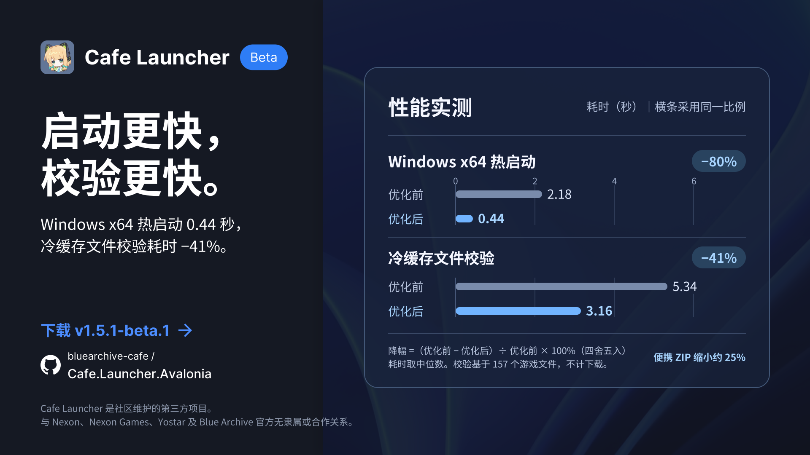

## v1.5.1-beta.1

### 启动更快，校验更快

本次更新优化了加载速度：Windows x64 版热启动到主窗口实测只需 **0.44 秒**，比优化前少等约 **80%**。
安装或更新游戏时，文件校验也更快：在冷缓存下，用同一份 157 个文件的游戏清单对比，校验耗时中位数从 **5.34 秒降到 3.16 秒**，缩短约 **41%**。

> [!NOTE]
> 本文涵盖自 `1.5.0-beta.1` 以来的变化。Windows 是正式支持平台，可在启动器内更新；macOS 和 Linux 仍提供实验性构建，可从发布页下载。
>
> 启动数据来自单台 Windows x64 电脑，校验数据仅统计文件校验阶段。实际耗时会随硬件、磁盘和缓存状态变化。

> [!WARNING]
> 使用 `1.1.0` 或更早版本的 Windows 免安装版时，请手动下载并解压新版。自行创建的快捷方式如果仍指向 `Cafe.Launcher.Avalonia.exe`，请改为指向 `Cafe.Launcher.exe`。

### Windows x64：打开更快，占用更少

主启动器和更新助手现在以 Native AOT 预编译。除了日常打开更快，新目录下首次启动的等待时间也从 **6.88 秒降到 2.61 秒**。主窗口空闲时的内存工作集少约 **71 MiB**，便携 ZIP 缩小约 **25%**。

| 实测项目 | 优化前 | 优化后 |
| --- | ---: | ---: |
| 热启动到主窗口 | 2.18 秒 | 0.44 秒 |
| 新目录首次启动到主窗口 | 6.88 秒 | 2.61 秒 |
| 主窗口空闲时的内存工作集 | 251.6 MiB | 180.2 MiB |
| 便携 ZIP | 125.79 MiB | 94.72 MiB |

从旧版 Windows 安装版覆盖升级时，安装器会清理已知的旧运行时文件，保留用户数据和游戏目录。

### 安装与更新：缩短文件校验等待

启动器会按需并行校验文件，并减少重复读取文件信息。冷缓存对比中，校验峰值内存工作集从 52.74 MiB 降到 48.82 MiB；热缓存下，峰值内存工作集下降 15.7%，耗时没有稳定改善。此处的提速指文件校验阶段，下载速度仍取决于网络和下载源。

### 其他改进

- **Linux 游戏状态**：更准确地识别 Wine 和 Proton 下的游戏进程，包括命令行未带游戏可执行文件名的辅助进程。
- **Linux 运行环境**：能沿 Steam 安装路径解析上层目录的符号链接，并在列表中合并重复的 Proton 构建。
- **Linux 桌面快捷方式**：AppImage 版生成的快捷方式现在直接指向 AppImage 文件；同时修复了带特殊字符的路径可能导致快捷方式无法启动的问题。
- **Linux 启动器实例**：应用数据路径过长时，启动器仍可打开；这种情况下可能同时打开多个窗口。
- **文件管理器与关于页**：打开目录失败时，启动器会处理错误，避免中断当前操作；关于页更新了贡献者简介。

展开查看测试条件

- **Windows x64 对照**：在 Windows 11 专业版 x64（内部版本 26300）、Intel Core i5-10400F、32 GiB RAM 和 SSD 上，用同一提交 `51e0ca5d` 和 .NET 10.0.15 构建两套自包含 Release，比较 JIT 与 Native AOT。
- **启动计时**：从创建进程计至检测到主窗口。每种构建各取六次的中位数；热启动先预热，新目录测试每次用无缓冲复制创建目录，仍可能保留 Windows 系统缓存。更新助手的 `--help` 另测十次，耗时中位数从 270 ms 降到 49 ms。
- **空闲采样**：每版持续五分钟，每十秒采样一次，比较第 2–5 分钟。测试关闭远程内容卡和启动器自更新检查，并启用减弱动效。
- **包体积**：两份 ZIP 都包含更新助手、调试符号和原生库，使用相同压缩设置。扣除调试符号后，发布目录从 228.42 MiB 缩小到 161.43 MiB。
- **文件校验对照**：使用游戏 1.74.0 的文件清单，共 157 个文件、1.06 GiB，对比校验调度优化前后。冷缓存数据仅涵盖本地校验，不计入下载时间。

