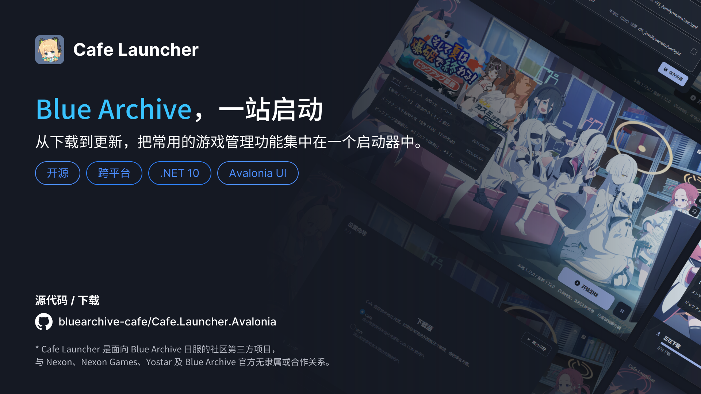

# Cafe Launcher

[简体中文](./README.md) · [English](./README.en.md)

A community-maintained, third-party desktop launcher for Blue Archive JP. Built with .NET 10 and Avalonia, it brings installation, updates, repair, launch, and uninstall into one window and works with game directories downloaded by the official launcher.

[](https://github.com/bluearchive-cafe/Cafe.Launcher.Avalonia)
[](https://github.com/bluearchive-cafe/Cafe.Launcher.Avalonia/releases/latest)
[](https://github.com/bluearchive-cafe/Cafe.Launcher.Avalonia/releases)
[](https://github.com/bluearchive-cafe/Cafe.Launcher.Avalonia/releases/latest)<br/>
[](https://github.com/bluearchive-cafe/Cafe.Launcher.Avalonia/actions/workflows/build.yml)


[](https://github.com/bluearchive-cafe/Cafe.Launcher.Avalonia/search?l=c%23)
[](./LICENSE)
[](#platform-support-and-packages)

[Download](https://github.com/bluearchive-cafe/Cafe.Launcher.Avalonia/releases) · [Installation and First Run](https://docs.bluearchive.cafe/en/cafe-launcher/installation) · [FAQ](https://docs.bluearchive.cafe/en/cafe-launcher/faq) · [Feedback Guide](https://docs.bluearchive.cafe/en/cafe-launcher/feedback) · [Developer Guide](#developer-guide)

> [!IMPORTANT]
> Cafe Launcher is a community project with no affiliation or partnership with Nexon, Nexon Games, Yostar, or the official Blue Archive team. Read the [privacy policy (Chinese)](./PRIVACY.md) before use.



## Contents

- [Features](#features)
- [Platform support and packages](#platform-support-and-packages)
- [Quick start](#quick-start)
- [Comparison with the official launcher](#comparison-with-the-official-launcher)
- [Linux support (experimental)](#linux-support-experimental)
- [Wallpaper sources](#wallpaper-sources)
- [Help and feedback](#help-and-feedback)
- [Developer guide](#developer-guide)
- [Local data and licensing](#local-data-and-licensing)
- [Acknowledgments](#acknowledgments)

## Features

Cafe Launcher can take over an existing official installation or download and manage the game from scratch. It offers resumable downloads, multiple sources, configurable launch verification, a multilingual interface, appearance customization, and local diagnostics.

- **Game management:** install, incrementally update, repair, launch, and uninstall. Manifests and configuration files remain compatible with the official launcher.
- **Download controls:** up to 10 concurrent transfers, resume, pause and continue, speed limits, and CRC64 verification.
- **Launch verification:** choose a local manifest, a remote manifest, or skip verification, following the official launcher's behavior.
- **Desktop experience:** English, Simplified Chinese, Traditional Chinese, and Japanese; system, light, and dark themes; custom backgrounds and accent colors.
- **Localization resources and diagnostics:** manage Chinese localization resources provided by the Cafe source using a UID; view and export logs for troubleshooting.
- **Launcher updates:** Windows supports in-app updates verified against the release's `SHA256SUMS`. macOS and Linux open the release page.

Settings, download state, and logs stay on your device. The launcher does not modify the game process or inject code into it. The launcher's interface language is independent of the game's resource language; the Cafe source provides Chinese localization.

## Platform support and packages

| Platform | Status | Packages |
| --- | --- | --- |
| Windows 10 1809+ / Windows 11, x64 | Officially supported | Installer (recommended), portable ZIP |
| macOS, Apple Silicon | Experimental; cannot launch the game | `.app` archive |
| Linux, x64 | Experimental | `.deb`, `.rpm`, `.pkg.tar.zst` (Arch), AppImage, `.tar.gz` |

Packages include the .NET Runtime, so no separate installation is needed.

The macOS launcher can install, update, and repair game files. It does not provide the compatibility layer needed to launch the Windows game. Linux can launch through Wine, UMU, or Proton; see [Linux support](#linux-support-experimental).

Prereleases are testing builds. Choose the latest stable release for everyday use. macOS and Linux have not received the same level of adaptation and testing as Windows; read the release notes for your version.

## Quick start

1. Open [Releases](https://github.com/bluearchive-cafe/Cafe.Launcher.Avalonia/releases) and download the package for your platform. Windows users should normally choose the installer, or portable ZIP if installation is not desired.
2. Open Cafe Launcher and use the first-run wizard to choose the interface language, download source, game directory, and proxy mode.
3. Select an existing `BlueArchive_JP` directory, or choose an installation location and install from the main window.
4. Update or start the game from the main window; repair and uninstall are also available in Settings.

See [Installation and First Run](https://docs.bluearchive.cafe/en/cafe-launcher/installation) for the complete walkthrough. The documentation also covers [settings](https://docs.bluearchive.cafe/en/cafe-launcher/settings), [game operations](https://docs.bluearchive.cafe/en/cafe-launcher/operations), the [Resource Panel](https://docs.bluearchive.cafe/en/cafe-launcher/resource-panel), and [uninstall and data](https://docs.bluearchive.cafe/en/cafe-launcher/uninstall).

## Comparison with the official launcher

Cafe Launcher shares the official launcher's **game directory and manifest format**. Installation and verification protocols stay compatible, so switching launchers does not require downloading the game again. This comparison is based on [static research of official launcher v1.7.2 (Chinese)](./docs/research/official-launcher-v1.7.2-comparison.md), a historical version; current official behavior may differ.

| Area | Official launcher v1.7.2 | Cafe Launcher |
| --- | --- | --- |
| Game running during installation | Uses `taskkill /F /T` on matching processes in the game directory before replacing files | Refuses writes with an explanation; checks again before writing and recognizes related anti-cheat processes |
| Download controls | Stores tasks in browser `localStorage` and re-enters them after restart; no session-level pause | Pause/continue, speed limits, exit recovery, and distinct user-stop and process-exit behavior |
| Uninstall scope | Manifest files and installation state | Entire game directory, state, and desktop shortcut; optional managed compatibility cleanup; preserves custom Prefixes outside the deletion targets |
| Localization resources | No corresponding feature identified | UID-based management of the Cafe source's Chinese localization resources |
| Diagnostics and privacy | Local logs, remotely controlled cloud log reporting, and AIHelp support | Local log viewing/export and crash reports; no remote telemetry |
| Interface languages | Japanese in the JP package | English / 简体中文 / 繁體中文 / 日本語 |
| Platforms | Windows | Windows supported; macOS and Linux experimental |

Official features not implemented here include `clickCode` file migration, temporarily moving/restoring game directories during self-update, and AIHelp support. Read the comparison's limitations before treating Cafe Launcher as an in-place replacement for the official installer.

## Linux support (experimental)

Linux can install, update, repair, and **launch** the game through a compatibility runtime. The full launch chain, including XIGNCODE3, has been verified on the single combination listed below.

On Arch Linux x86_64, download the `.pkg.tar.zst` from [Releases](https://github.com/bluearchive-cafe/Cafe.Launcher.Avalonia/releases) and install the downloaded file with `sudo pacman -U`. Alternatively, build and install from the release tag with the repository's [PKGBUILD](./installer/linux/arch/PKGBUILD):

```bash
sudo pacman -S --needed base-devel git
git clone https://github.com/bluearchive-cafe/Cafe.Launcher.Avalonia.git
cd Cafe.Launcher.Avalonia/installer/linux/arch
makepkg -si
cafe-launcher
```

`makepkg` installs the required .NET 10 SDK and system dependencies; the resulting package includes the .NET Runtime. Fetch the updated recipe and rebuild to update. Configure Wine, UMU, or Proton separately as described below.

### Configure a compatibility runtime

Use Settings → Game → Compatibility Runtime:

| Setting | Description |
| --- | --- |
| Runtime | Auto prefers UMU; UMU / Proton and Wine can also be selected explicitly. Choose a compatibility runtime rather than Windows (Native) |
| Runner path | Leave blank to detect `umu-run` / `wine`, or select an executable |
| Proton path | Custom Proton build for UMU; leave blank for UMU's selection |
| Prefix path | Leave blank for separate launcher-managed prefixes per runner, or select your own |

### Additional Linux behavior

- **Preflight checks:** detect unwritable prefixes, `noexec` mounts, and filesystems without symbolic links, then explain blocking issues and remedies. Distribution and case sensitivity are recorded without independently blocking launch.
- **Protection while running:** ownership markers identify game processes started by the launcher, including through UMU/pressure-vessel and after the launcher exits. Processes launched through other entry points that occupy the installation are also checked.
- **Automatic UID reading:** the Resource Panel reads the UID from game Cookie data in the configured compatibility prefix.
- **Diagnostics:** exported information includes runner process snapshots and stdout/stderr, GPU and Vulkan detection, desktop session type, prefix metadata, and locally installed Proton builds.
- **Single instance and proxy:** another launch activates the existing instance. System proxy mode reads GNOME proxy settings.

### Verified combination and limits

On 2026-09-22, a Debug build was tested on **Arch Linux + UMU 1.4.4 + UMU-Proton 10.0-4 + an NTFS3 game directory**. First launch, login, gameplay, exit, and relaunch succeeded without an XIGNCODE3 block. See the [hardware verification record (Chinese)](./docs/design/linux-p0a-verification-2026-09-22.md).

Other distributions, Proton builds, and graphics drivers remain **unverified**. Anti-cheat compatibility depends on these components, and major updates may require retesting.

## Wallpaper sources

Settings → Appearance → Background offers three sources.

### Bundled wallpaper

The default wallpaper is cropped from **[初めてのゲーム](https://www.pixiv.net/artworks/142932674)** by Pixiv artist **めるき (Meruki)**, artwork ID `142932674`.

- The bundled file is `src/Cafe.Launcher.UI/Assets/launcher-background.png` (2560 × 1388), center-cropped and converted to PNG.
- Original and cropped source materials are archived in [`docs/assets/art-sources/`](./docs/assets/art-sources/), outside application packaging: `142932674_p0.jpg` (2970 × 1610) and `142932674_p0_cut.jpg` (2560 × 1388).
- Attribution also appears under Settings → About → Legal, with a link to the [original Pixiv artwork](https://www.pixiv.net/artworks/142932674).

**The illustration belongs to めるき (Meruki).** It is used only as the launcher background, is excluded from the source code's MIT license, and must not be extracted for other uses. Contact the artist for permission to use it elsewhere.

### Remote wallpaper

Remote mode reads `LauncherBackgroundImg` and its CRC64 from the official game launcher configuration. The image is downloaded into the local cache and decoded for the window size. Yostar's API supplies it; copyright belongs to its rights holders. It is not distributed in this project's packages.

The launcher falls back to the bundled wallpaper if downloading fails or no image is configured.

### Custom wallpaper

Choose a local image or a folder from which an image is randomly selected on refresh. Supported formats are `.png`, `.jpg`, `.jpeg`, `.bmp`, and `.webp`. These files stay local; users are responsible for their rights and permissions. The project does not collect, upload, or distribute them.

The repository's [key visual](./docs/assets/key-visual.png) and release banners are project-created promotional materials containing launcher screenshots.

## Help and feedback

Check the [FAQ](https://docs.bluearchive.cafe/en/cafe-launcher/faq), then follow the [Feedback Guide](https://docs.bluearchive.cafe/en/cafe-launcher/feedback) to prepare your version, reproduction steps, screenshots, and diagnostic logs.

Search [existing Issues](https://github.com/bluearchive-cafe/Cafe.Launcher.Avalonia/issues) first. If new Issues are unavailable or the matter is private, use the contact email in the feedback guide. Review logs for local paths and other private information before sharing.

## Developer guide

The [development guide (Chinese)](docs/DEVELOPMENT.md) is the shared reference for setup, build/run commands, tests, dependency upgrades, and releases. Repository scripts require PowerShell 7. Windows is supported; macOS/Linux builds are experimental.

- [Engineering conventions](PROJECT_CONVENTIONS.md): assembly and feature boundaries, coding, localization, DI, and tests.
- [Domain contracts](CONTEXT.md) and [UI terminology](UBIQUITOUS_LANGUAGE.md): behavioral invariants and canonical translations.
- [Architecture decisions](docs/design/adr/README.md) and [audit status](CODEBASE_AUDIT.md): rationale, current findings, and accepted risks.
- [AGENTS.md](AGENTS.md): task routing for coding agents.

Contributor documentation is primarily in Chinese; both READMEs link to the same maintained rules.

## Local data and licensing

On Windows, settings, download state, and logs default to `%LOCALAPPDATA%\Cafe Launcher\`. Manifest and configuration files in the game directory record installation state and remain compatible with the official launcher. Uninstalling the launcher preserves game files by default. See [Uninstall and Data](https://docs.bluearchive.cafe/en/cafe-launcher/uninstall).

Source code is released under the [MIT License](./LICENSE). Third-party components and their licenses are listed in [THIRD-PARTY-NOTICES.md](./THIRD-PARTY-NOTICES.md).

The bundled wallpaper belongs to めるき (Meruki) and is excluded from the MIT license. See [Wallpaper sources](#wallpaper-sources).

## Acknowledgments

- The default wallpaper is [初めてのゲーム](https://www.pixiv.net/artworks/142932674) by [めるき (Meruki)](https://www.pixiv.net/users/15737611). Copyright remains with the artist; this project uses it only as a launcher background and claims no ownership.
- Thanks to [Avalonia](https://avaloniaui.net/), [Material.Icons.Avalonia](https://github.com/SKProCH/Material.Icons.Avalonia), [CommunityToolkit.Mvvm](https://github.com/CommunityToolkit/dotnet), and the other open-source projects used here.
- Thanks to everyone who reports issues, shares feedback, and helps test the launcher.
