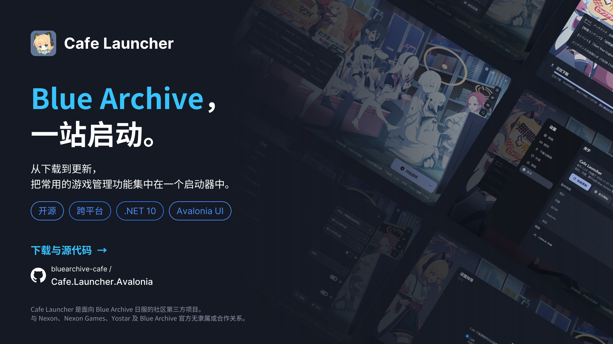

# Cafe Launcher

[Simplified Chinese](README.md) | [English](README.en.md)

A community-built desktop launcher for Blue Archive JP, written in .NET 10 and Avalonia. It can adopt an existing game directory created by the official launcher or install from scratch, then update, repair, launch, and uninstall from one window.

[](https://github.com/bluearchive-cafe/Cafe.Launcher.Avalonia)
[](https://github.com/bluearchive-cafe/Cafe.Launcher.Avalonia/releases/latest)
[](https://github.com/bluearchive-cafe/Cafe.Launcher.Avalonia/releases)
[](https://github.com/bluearchive-cafe/Cafe.Launcher.Avalonia/releases)<br/>
[](https://github.com/bluearchive-cafe/Cafe.Launcher.Avalonia/actions/workflows/build.yml)


[](https://github.com/bluearchive-cafe/Cafe.Launcher.Avalonia/search?l=c%23)
[](LICENSE)
[](#platforms-and-packages)

[Download](https://github.com/bluearchive-cafe/Cafe.Launcher.Avalonia/releases) | [Documentation](https://docs.bluearchive.cafe/en/cafe-launcher/) | [FAQ](https://docs.bluearchive.cafe/en/cafe-launcher/faq) | [Report a problem](https://docs.bluearchive.cafe/en/cafe-launcher/feedback)

> [!IMPORTANT]
> This community project is not affiliated with Nexon, Nexon Games, Yostar, or the official Blue Archive team. Read the [User Agreement](TERMS.md) and [Privacy Policy](PRIVACY.md) before use; the Chinese versions are authoritative. The Chinese versions of both documents are authoritative.



## What it does

| Area | Details |
| --- | --- |
| Game management | Reuses the official game directory and manifest; installs, incrementally updates, repairs with CRC64, launches, and uninstalls |
| Download control | Official and Cafe download sources; up to 10 concurrent transfers with pause, resume, resumable downloads, and speed limits |
| Launch verification | Local manifest, remote manifest, or no check; verifies file existence and size, while Repair handles content integrity |
| Chinese-localized resources | An eight-uppercase-letter localization UID manages game text, main-story Chinese voice, and image/video resources in the Resource Panel |
| Appearance | English, Simplified Chinese, Traditional Chinese, and Japanese interfaces; themes, image and video backgrounds, wallpaper-derived colors; preview, save, or discard changes |
| Diagnostics and updates | Local log viewer and export; Windows update packages are verified against the release `SHA256SUMS` and applied by a separate updater helper |

Settings, download recovery records, and diagnostic logs stay on your device, and logs are never uploaded automatically. The Resource Panel submits the localization UID and resource switches to the BlueArchive.Cafe service. The launcher does not modify the game process or inject code into it.

## Platforms and packages

| Platform | Architecture and packages | Scope |
| --- | --- | --- |
| Windows 10 1809+ / Windows 11 | x64; installer, portable ZIP | Supported, including game launch, video backgrounds, and in-app updates |
| macOS | Apple Silicon; .app ZIP | Experimental; installs, updates, and repairs game files, but cannot launch the game |
| Linux | x64; DEB, RPM, Arch package, AppImage, tar.gz | Experimental; launches the game through separately installed UMU / Proton or Wine |

The Windows x64 launcher and updater are published as Native AOT and need no separate .NET installation; macOS and Linux packages include the .NET Runtime. Video backgrounds are available on Windows x64, Linux x64, and macOS Apple Silicon builds. Update the launcher manually from the release page on macOS and Linux. Prereleases are testing builds; choose the latest stable release for everyday use.

Linux anti-cheat compatibility depends on the distribution, runner, Proton build, and drivers. Historical hardware testing covers Arch Linux + UMU 1.4.4 + UMU-Proton 10.0-4 with game files on NTFS3, which does not establish compatibility with other combinations or later game versions. See [Compatibility runtime](https://docs.bluearchive.cafe/en/cafe-launcher/settings#compatibility-runtime-linux-only), including the optional MangoHud overlay, which is disabled by default and installed separately.

## Windows security warnings: SmartScreen and Smart App Control

The Windows packages are currently not Authenticode-signed. Microsoft Defender SmartScreen may report an unknown publisher or "Windows protected your PC", and Smart App Control on Windows 11 may block the installer or `Cafe.Launcher.exe` outright. These prompts are based on signing and reputation; they do not mean malware was detected.

- Download only from [Releases](https://github.com/bluearchive-cafe/Cafe.Launcher.Avalonia/releases), and verify files against the same release's `SHA256SUMS`.
- If SmartScreen offers **More info**, expand it and choose **Run anyway**. For the portable ZIP, open **Properties** and select **Unblock** before extracting.
- Smart App Control usually offers no **Run anyway**. Turning it off reduces protection against unsigned and untrusted programs, and turning it back on normally requires resetting or reinstalling Windows.
- Enterprise, school, or security-software policies may prohibit unsigned programs entirely; the steps above cannot bypass them.

See [Windows security warnings](https://docs.bluearchive.cafe/en/cafe-launcher/installation#windows-security-warnings) for the full steps. Whether to bypass a system prompt or disable a security feature is your decision and risk; the maintainers do not recommend disabling SmartScreen, Smart App Control, or antivirus protection globally for this app, and are not responsible for resulting system damage, data loss, or account issues. The signing policy may change; release notes are authoritative.

## Download and first run

1. Download the complete package for your platform from [Releases](https://github.com/bluearchive-cafe/Cafe.Launcher.Avalonia/releases). Most Windows users can use `Cafe.Launcher_v<version>_setup.exe`; extract the whole portable ZIP before running `Cafe.Launcher.exe`. The installer may trigger SmartScreen or Smart App Control; read the section above first.
2. Complete the setup wizard: welcome, language, user agreement and privacy policy, game installation path, download source, proxy, and confirmation. Setup cannot continue without accepting the agreement. Chinese system languages default to Cafe; other languages default to Official.
3. Select an existing `BlueArchive_JP` directory, or choose a base directory and confirm the final `YostarGames/BlueArchive_JP` path before installing.
4. When ready, select **Start Game**. The adjacent menu provides update checks, opening the game directory, repair, uninstall, and other actions. Game desktop shortcuts support Windows and Linux (keep the AppImage file in place).

See [Installation and first run](https://docs.bluearchive.cafe/en/cafe-launcher/installation) for the full steps. After switching download sources, repair as prompted so files match the selected manifest. When two launchers share one game directory, avoid touching files at the same time.

| Task | Guide |
| --- | --- |
| Change language, network, paths, motion, or colors | [Settings reference](https://docs.bluearchive.cafe/en/cafe-launcher/settings) |
| Download, repair, launch, and use the tray | [Game operations](https://docs.bluearchive.cafe/en/cafe-launcher/operations) |
| Switch localized resources or enter a UID | [Resource Panel](https://docs.bluearchive.cafe/en/cafe-launcher/resource-panel) |
| Remove the game, launcher, or user data | [Uninstall and data](https://docs.bluearchive.cafe/en/cafe-launcher/uninstall) |
| Troubleshoot and submit logs | [FAQ](https://docs.bluearchive.cafe/en/cafe-launcher/faq), [Feedback guide](https://docs.bluearchive.cafe/en/cafe-launcher/feedback) |

## Differences from the official launcher

Both launchers understand `manifest.json` and `game-launcher-config.json` in the game directory, so switching does not require downloading the whole game again. Cafe Launcher adds two download sources, download controls, the Chinese-localization Resource Panel, interface customization, and local diagnostics.

The [official launcher v1.7.2 comparison](docs/research/official-launcher-v1.7.2-comparison.md) records a static analysis of that historical version for protocol and feature context; the current official build may differ.

## Appearance and backgrounds

The bundled default wallpaper is [《初めてのゲーム》](https://www.pixiv.net/artworks/142932674) by [めるき (Meruki)](https://www.pixiv.net/users/15737611); copyright remains with the artist, and it is not covered by this project's MIT license.

Remote backgrounds come from image addresses in the official launcher configuration, are downloaded to a local cache on demand, and fall back to the bundled background on failure; rights remain with their owners, and release packages do not include those images. Custom images, videos, or folders are chosen by the user, are never uploaded or redistributed, and their usage rights are the user's responsibility.

Windows x64 and the Linux and macOS portable builds bundle the video runtime; Linux system packages install it through the package manager. Video volume defaults to 0, while the independent mute switch retains the chosen volume. Playback pauses when the window is minimized or hidden to tray, and reduced motion pauses playback and shows the first frame as a still. Accent colors come from the video cover or first frame and do not change per frame. Appearance changes preview immediately, persist on save, and revert on discard. See [Background](https://docs.bluearchive.cafe/en/cafe-launcher/settings#background) for formats and fallbacks; motion lives under **Appearance → Theme and motion**, and extraction algorithms under the collapsed **Advanced colors** section. The repository key visual and release banners are promotional assets made for this project.

## Data and licensing

Launcher binaries, user data, and the game directory are independent. Uninstalling the launcher keeps the game; uninstalling the game inside the app deletes the whole game directory by default, including files outside the manifest, so review the confirmed scope first.

| Platform | User data directory |
| --- | --- |
| Windows | `%LOCALAPPDATA%\Cafe Launcher` |
| macOS | `~/Library/Application Support/Cafe Launcher` |
| Linux | `$XDG_DATA_HOME/cafe-launcher`; `~/.local/share/cafe-launcher` without a valid absolute XDG path |

Linux upgrades attempt to migrate the old `Cafe Launcher` directory in the same data home, keeping existing destination content and files that could not be moved. Check the location under **Settings → Advanced → Open Data Directory** before cleaning up.

Source code is available under the [MIT License](LICENSE); third-party notices are in [THIRD-PARTY-NOTICES.md](THIRD-PARTY-NOTICES.md). Thanks to Avalonia, CommunityToolkit.Mvvm, Material.Icons.Avalonia, and the other open-source projects, as well as everyone who tested, translated, or reported issues.

## Development and documentation

Install the SDK pinned by [global.json](global.json) and PowerShell 7, then run:

```powershell
pwsh ./build.ps1
dotnet run --project ./src/Cafe.Launcher/Cafe.Launcher.csproj
```

See the [Development guide](docs/DEVELOPMENT.md) for environment, tests, and validation. `build.ps1` builds only the launcher host graph; build the updater separately.

| Need | Entry point |
| --- | --- |
| Find every document by usage, development, design, or history | [Documentation map](docs/README.md) |
| Environment, commands, validation, dependencies, release | [Development guide](docs/DEVELOPMENT.md) |
| Assembly boundaries, style, localization, DI, tests, persistence | [Implementation conventions](PROJECT_CONVENTIONS.md) |
| Behavior contracts and four-language terminology | [Domain contracts](CONTEXT.md), [terminology](UBIQUITOUS_LANGUAGE.md) |
| Decisions, current findings, accepted risks | [ADRs](docs/design/adr/README.md), [audit ledger](CODEBASE_AUDIT.md) |
| Server release metadata, notices, download mirrors | [Cafe.Launcher.Backend](https://github.com/bluearchive-cafe/Cafe.Launcher.Backend), [Cafe.Launcher.Downloads](https://github.com/bluearchive-cafe/Cafe.Launcher.Downloads) |
| Task entry point for coding agents | [AGENTS.md](AGENTS.md) |
