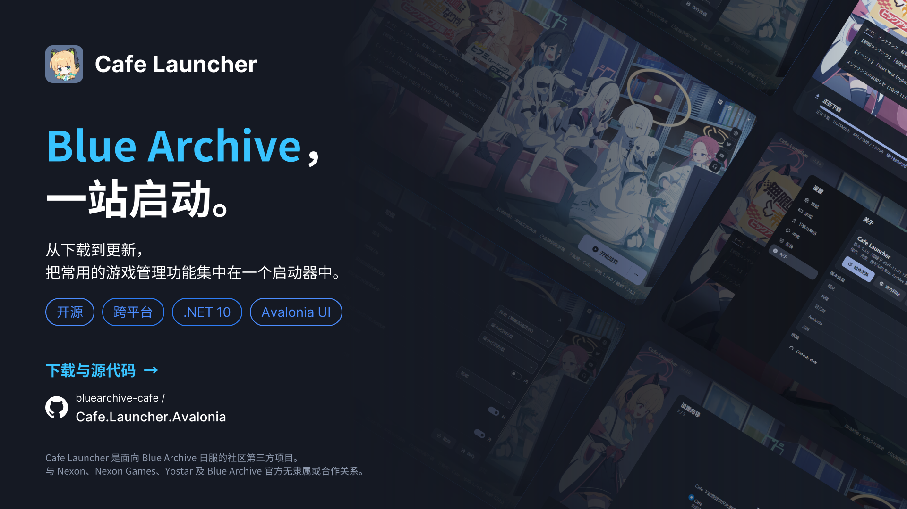

# Cafe Launcher

[简体中文](README.md) | [English](README.en.md)

A community desktop launcher for Blue Archive JP, built with .NET 10 and Avalonia. Reuse an official game installation or start from scratch, then update, repair, launch, and uninstall from one application.

[](https://github.com/bluearchive-cafe/Cafe.Launcher.Avalonia)
[](https://github.com/bluearchive-cafe/Cafe.Launcher.Avalonia/releases/latest)
[](https://github.com/bluearchive-cafe/Cafe.Launcher.Avalonia/releases)
[](https://github.com/bluearchive-cafe/Cafe.Launcher.Avalonia/releases)<br/>
[](https://github.com/bluearchive-cafe/Cafe.Launcher.Avalonia/actions/workflows/build.yml)


[](https://github.com/bluearchive-cafe/Cafe.Launcher.Avalonia/search?l=c%23)
[](LICENSE)
[](#platforms-and-packages)

[Download](https://github.com/bluearchive-cafe/Cafe.Launcher.Avalonia/releases) | [User documentation](https://docs.bluearchive.cafe/en/cafe-launcher/) | [FAQ](https://docs.bluearchive.cafe/en/cafe-launcher/faq) | [Report a problem](https://docs.bluearchive.cafe/en/cafe-launcher/feedback)

> [!IMPORTANT]
> This community project is not affiliated with Nexon, Nexon Games, Yostar, or the official Blue Archive team. Read the [privacy policy (Chinese)](PRIVACY.md) before use.



## Features

| Capability | What it provides |
| --- | --- |
| Game management | Compatible official game directories and manifests; installation, incremental updates, CRC64 repair, launch, and uninstall |
| Download controls | Up to 10 concurrent transfers, pause, resume, saved progress, speed limits, and Official or Cafe download sources |
| Launch verification | Local manifest, remote manifest, or no check; verifies file existence and size, while repair checks file contents |
| Chinese-localized resources | Manage game text, main-story Chinese voice, and image/video resources using an eight-letter uppercase UID |
| Appearance | English, Simplified Chinese, Traditional Chinese, and Japanese; themes, image/video backgrounds, wallpaper colors; preview, save, or discard changes |
| Diagnostics and updates | Local log viewing and export; Windows updates checked against the same release's SHA256SUMS and applied by a separate updater |

Settings, download recovery records, and diagnostic logs stay on your device; logs are not uploaded automatically. The Resource Panel submits your UID and resource selections to BlueArchive.Cafe. The launcher does not modify or inject code into the game process.

## Platforms and packages

| Platform | Architecture and packages | Support |
| --- | --- | --- |
| Windows 10 1809+ / Windows 11 | x64; installer or portable ZIP | Supported, including game launch, video backgrounds, and in-app updates |
| macOS | Apple Silicon; .app ZIP | Experimental; installs, updates, and repairs game files; cannot launch the game |
| Linux | x64; DEB, RPM, Arch package, AppImage, tar.gz | Experimental; game launch through separately installed UMU / Proton or Wine |

Packages include the .NET Runtime. Video backgrounds are available on Windows x64 and experimental Linux x64 and macOS Apple Silicon builds. Update the launcher manually from the release page on macOS and Linux. Prereleases are testing builds; choose the latest stable release for everyday use.

Linux anti-cheat compatibility depends on the distribution, runner, Proton build, and driver. Historical hardware testing includes Arch Linux + UMU 1.4.4 + UMU-Proton 10.0-4 with game files on NTFS3. This does not establish compatibility with other combinations or later game versions. See [Compatibility runtime](https://docs.bluearchive.cafe/en/cafe-launcher/settings#compatibility-runtime-linux-only), including the optional MangoHud overlay, disabled by default and installed separately.

## Get started

1. Download the complete package for your platform from [Releases](https://github.com/bluearchive-cafe/Cafe.Launcher.Avalonia/releases). Most Windows users can use `Cafe.Launcher_v<version>_setup.exe`; extract the entire portable ZIP before running `Cafe.Launcher.exe`.
2. Complete the setup wizard: language, download source, game installation path, proxy, and confirmation. Chinese system languages default to Cafe; other languages default to Official.
3. Select an existing `BlueArchive_JP` directory, or choose a base directory and confirm the final `YostarGames/BlueArchive_JP` path before installing.
4. When ready, select **Start Game**. The adjacent dropdown provides update checks, the game directory, repair, uninstall, and other actions. Game desktop shortcuts currently require Windows.

See [Installation and First Run](https://docs.bluearchive.cafe/en/cafe-launcher/installation). After switching download sources, repair when prompted so files match the selected manifest. Avoid simultaneous file operations when sharing a directory with the official launcher.

| Task | Guide |
| --- | --- |
| Change language, networking, paths, motion, or colors | [Settings](https://docs.bluearchive.cafe/en/cafe-launcher/settings) |
| Download, repair, launch, or use the tray | [Game operations](https://docs.bluearchive.cafe/en/cafe-launcher/operations) |
| Configure Chinese-localized resources and UID | [Resource Panel](https://docs.bluearchive.cafe/en/cafe-launcher/resource-panel) |
| Remove game files, the launcher, or user data | [Uninstall and data](https://docs.bluearchive.cafe/en/cafe-launcher/uninstall) |
| Troubleshoot and collect logs | [FAQ](https://docs.bluearchive.cafe/en/cafe-launcher/faq), [feedback](https://docs.bluearchive.cafe/en/cafe-launcher/feedback) |

## Comparison with the official launcher

Both launchers can use the same `manifest.json`, `game-launcher-config.json`, and game directory. Switching does not require downloading the whole game again. Cafe Launcher adds download sources and controls, the Resource Panel, appearance customization, and local diagnostics.

The [official launcher v1.7.2 comparison (Chinese)](docs/research/official-launcher-v1.7.2-comparison.md) records static research of one historical version. Current official releases may behave differently.

## Appearance and backgrounds

The bundled wallpaper is [初めてのゲーム](https://www.pixiv.net/artworks/142932674) by [めるき (Meruki)](https://www.pixiv.net/users/15737611). Copyright remains with the artist; the project MIT license does not cover this artwork.

Remote backgrounds use the image address supplied by the official launcher configuration. They are downloaded to the local cache and fall back to the bundled wallpaper on failure. Rights remain with their respective holders; these images are not included in project packages. Custom images, videos, and folders are selected locally, never uploaded or distributed by the project. Users are responsible for permission to use them.

Windows x64 and Linux and macOS portable packages include the video runtime; Linux system packages use a package-manager dependency. Volume defaults to 0, and muting retains your chosen volume. Playback pauses when minimized or hidden to the tray; reduced motion pauses it and shows the first frame as a still. Colors come from cover art or the first frame and remain stable during playback. Appearance changes preview immediately; save to persist them or discard to restore the previous state. See [Background settings](https://docs.bluearchive.cafe/en/cafe-launcher/settings#background). Motion is under **Appearance → Theme and motion**; extraction algorithms are in the collapsed **Advanced colors** section. Repository key visuals and release banners are project-created promotional materials.

## Data and licensing

The application, user data, and game directory are separate. Removing the launcher preserves game files. Uninstalling the game from the application deletes the entire game directory, including files outside the manifest; check the confirmation before proceeding.

| Platform | User data directory |
| --- | --- |
| Windows | `%LOCALAPPDATA%\Cafe Launcher` |
| macOS | `~/Library/Application Support/Cafe Launcher` |
| Linux | `$XDG_DATA_HOME/cafe-launcher`, or `~/.local/share/cafe-launcher` when no valid absolute XDG path is set |

Linux upgrades attempt to migrate the old `Cafe Launcher` directory within the same data home, preserving existing destination entries and old files that could not be moved. Check **Settings → Advanced → Open Data Directory** before cleaning up.

Source code uses the [MIT License](LICENSE). See [THIRD-PARTY-NOTICES.md](THIRD-PARTY-NOTICES.md) for component licenses. Thanks to Avalonia, CommunityToolkit.Mvvm, Material.Icons.Avalonia, the other open-source dependencies, and everyone contributing tests, translations, and feedback.

## Development and documentation

Install the SDK specified in [global.json](global.json) and PowerShell 7, then run:

```powershell
pwsh ./build.ps1
dotnet run --project ./src/Cafe.Launcher/Cafe.Launcher.csproj
```

Follow the [development guide (Chinese)](docs/DEVELOPMENT.md) for prerequisites, tests, and validation. `build.ps1` builds the launcher host graph; build the independent updater separately.

| Need | Entry point |
| --- | --- |
| Find all documentation by user, engineering, design, and history | [Documentation index](docs/README.md) |
| Environment, commands, validation, dependencies, and release | [Development guide](docs/DEVELOPMENT.md) |
| Assemblies, coding, localization, DI, tests, and persistence | [Engineering conventions](PROJECT_CONVENTIONS.md) |
| Behavioral invariants and canonical translations | [Domain contracts](CONTEXT.md), [terminology](UBIQUITOUS_LANGUAGE.md) |
| Rationale, current findings, and accepted risks | [Architecture decisions](docs/design/adr/README.md), [audit ledger](CODEBASE_AUDIT.md) |
| Release metadata service, notices, and download mirror | [Cafe.Launcher.Backend](https://github.com/bluearchive-cafe/Cafe.Launcher.Backend), [Cafe.Launcher.Downloads](https://github.com/bluearchive-cafe/Cafe.Launcher.Downloads) |
| Task routing for coding agents | [AGENTS.md](AGENTS.md) |

Contributor documentation is primarily in Chinese; both READMEs point to the same maintained rules.
