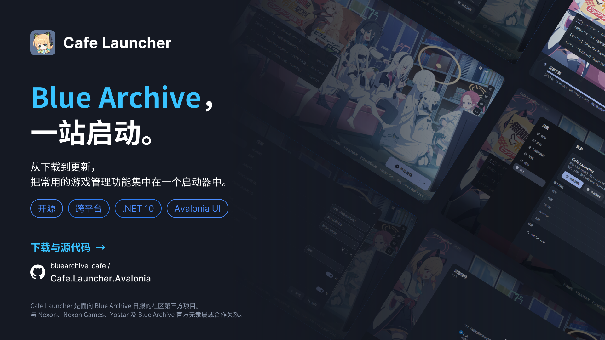

# Cafe Launcher

[简体中文](README.md) | [English](README.en.md)

面向 Blue Archive 日服的社区第三方桌面启动器，基于 .NET 10 与 Avalonia 构建。可以接管官方启动器已有的游戏目录，也可以从零安装，并完成更新、修复、启动和卸载。

[](https://github.com/bluearchive-cafe/Cafe.Launcher.Avalonia)
[](https://github.com/bluearchive-cafe/Cafe.Launcher.Avalonia/releases/latest)
[](https://github.com/bluearchive-cafe/Cafe.Launcher.Avalonia/releases)
[](https://github.com/bluearchive-cafe/Cafe.Launcher.Avalonia/releases)<br/>
[](https://github.com/bluearchive-cafe/Cafe.Launcher.Avalonia/actions/workflows/build.yml)


[](https://github.com/bluearchive-cafe/Cafe.Launcher.Avalonia/search?l=c%23)
[](LICENSE)
[](#平台支持与发行包)

[下载发行包](https://github.com/bluearchive-cafe/Cafe.Launcher.Avalonia/releases) | [使用文档](https://docs.bluearchive.cafe/cafe-launcher/) | [常见问题](https://docs.bluearchive.cafe/cafe-launcher/faq) | [反馈问题](https://docs.bluearchive.cafe/cafe-launcher/feedback)

> [!IMPORTANT]
> 本项目由社区维护，与 Nexon、Nexon Games、Yostar 及 Blue Archive 官方无隶属或合作关系。使用前请阅读[隐私政策](PRIVACY.md)。



## 启动器能做什么

| 能力 | 说明 |
| --- | --- |
| 游戏管理 | 复用官方游戏目录与安装清单；安装、增量更新、CRC64 修复、启动和卸载 |
| 下载控制 | 最多 10 个并发传输，暂停、继续、断点续传和限速；提供官方下载源与 Cafe 下载源 |
| 启动校验 | 选择本地文件清单、远程文件清单或跳过检查；检查文件存在性和大小，完整内容校验使用修复 |
| 汉化资源 | 使用八位大写字母 UID，在资源面板管理游戏文本、主线中配、图像视频三类资源 |
| 外观 | English、简体中文、繁體中文、日本語界面；主题、图片与视频背景、壁纸取色；可预览、保存或放弃 |
| 诊断与更新 | 本地日志查看与导出；Windows 更新包按同一版本的 SHA256SUMS 校验，再由独立更新助手应用 |

设置、下载恢复记录和诊断日志保存在本机，日志不会自动上传。资源面板会将 UID 和资源开关提交到蔚蓝咖啡厅服务端。启动器不修改游戏进程，也不向游戏注入代码。

## 平台支持与发行包

| 平台 | 架构与发行包 | 支持范围 |
| --- | --- | --- |
| Windows 10 1809+ / Windows 11 | x64；安装程序、便携 ZIP | 正式支持，含游戏启动、视频背景及应用内更新 |
| macOS | Apple Silicon；.app ZIP | 实验性；可安装、更新、修复游戏，暂不支持启动游戏 |
| Linux | x64；DEB、RPM、Arch 包、AppImage、tar.gz | 实验性；通过自行安装的 UMU / Proton 或 Wine 启动游戏 |

发行包自带 .NET Runtime。视频播放目前仅支持 Windows x64，其他平台使用静态回退。macOS、Linux 更新启动器时前往发布页手动安装。带预发布标签的版本用于测试，日常使用可选择最新稳定版。

Linux 的反作弊兼容性取决于发行版、运行器、Proton 和驱动。历史实机记录包含 Arch Linux + UMU 1.4.4 + UMU-Proton 10.0-4 + NTFS3 组合，不能据此保证其他组合或后续游戏版本可用。配置与排障见[兼容运行环境](https://docs.bluearchive.cafe/cafe-launcher/settings#兼容运行环境-仅-linux)，其中 MangoHud 为需自行安装、默认关闭的可选性能叠层。

## 开始使用

1. 从 [Releases](https://github.com/bluearchive-cafe/Cafe.Launcher.Avalonia/releases) 下载对应平台的完整发行包。Windows 通常选择 `Cafe.Launcher_v<版本>_setup.exe`；便携版完整解压后运行 `Cafe.Launcher.exe`。
2. 完成首次向导：语言、下载源、游戏安装路径、代理、确认。中文系统默认选择 Cafe 下载源，其他语言环境默认选择官方下载源。
3. 已有游戏时选择现有 `BlueArchive_JP` 目录；尚未安装时选择基础目录，确认最终路径为 `YostarGames/BlueArchive_JP` 后安装。
4. 游戏就绪后点击“开始游戏”。右侧下拉入口提供检查更新、打开目录、修复、卸载等操作；游戏桌面快捷方式仅支持 Windows。

完整步骤见[安装与首次使用](https://docs.bluearchive.cafe/cafe-launcher/installation)。切换下载源后按提示修复，使文件与所选清单一致。两个启动器使用同一游戏目录时，避免同时操作文件。

| 要做的事 | 文档 |
| --- | --- |
| 修改语言、网络、路径、动效或配色 | [设置参考](https://docs.bluearchive.cafe/cafe-launcher/settings) |
| 下载、修复、启动和托盘操作 | [游戏操作](https://docs.bluearchive.cafe/cafe-launcher/operations) |
| 切换汉化资源、填写 UID | [资源面板](https://docs.bluearchive.cafe/cafe-launcher/resource-panel) |
| 删除游戏、启动器或用户数据 | [卸载与数据](https://docs.bluearchive.cafe/cafe-launcher/uninstall) |
| 排障与提交日志 | [常见问题](https://docs.bluearchive.cafe/cafe-launcher/faq)、[反馈指南](https://docs.bluearchive.cafe/cafe-launcher/feedback) |

## 与官方启动器的区别

双方兼容游戏目录中的 `manifest.json` 和 `game-launcher-config.json`，切换启动器无需重新下载完整游戏。Cafe Launcher 额外提供双下载源、下载控制、汉化资源面板、界面定制和本地诊断。

[官方启动器 v1.7.2 对比研究](docs/research/official-launcher-v1.7.2-comparison.md)记录了特定历史版本的静态分析，供了解协议与功能差异时参考；现行官方版本可能已有变化。

## 壁纸来源

内置默认壁纸为 [めるき（Meruki）](https://www.pixiv.net/users/15737611)的[《初めてのゲーム》](https://www.pixiv.net/artworks/142932674)，版权归原作者，不在本项目 MIT 许可范围内。

远程背景来自官方启动器配置中的图片地址，按需下载到本机缓存，失败时回退到内置背景；版权归相应权利人，项目发行包不包含该图片。自定义图片、视频或文件夹由用户选择，不会上传或随项目分发，使用许可由用户自行确认。

Windows x64 随包提供视频运行库。视频音量默认为 0，独立静音开关保留所选音量；最小化、隐藏到托盘或减少动态效果时暂停。主题色使用视频封面或首帧，不逐帧变化。外观修改即时预览，保存后持久化，放弃时恢复。格式与回退规则见[背景设置](https://docs.bluearchive.cafe/cafe-launcher/settings#背景)；动效位于“外观 → 主题与动效”，取色算法位于默认折叠的“高级配色”。仓库主视觉与发布横幅为项目制作的宣传物料。

## 开发者指南

安装 [global.json](global.json) 指定的 SDK 与 PowerShell 7 后执行：

```powershell
pwsh ./build.ps1
dotnet run --project ./src/Cafe.Launcher/Cafe.Launcher.csproj
```

环境、测试和验证见[开发指南](docs/DEVELOPMENT.md)。`build.ps1` 只构建启动器宿主引用图；独立更新助手需单独构建。

- [文档导航](docs/README.md)：按使用、开发、设计和历史研究查找资料。
- [开发规范](PROJECT_CONVENTIONS.md)：程序集边界、编码、本地化、DI、测试与持久化规则。
- [领域契约](CONTEXT.md)与[术语表](UBIQUITOUS_LANGUAGE.md)：行为约束和四语言统一译名。
- [架构决策](docs/design/adr/README.md)与[审计台账](CODEBASE_AUDIT.md)：决策依据、当前发现及已接受风险。
- [AGENTS.md](AGENTS.md)：编码代理的任务入口。

## 数据与许可

启动器程序、用户数据和游戏目录彼此独立。卸载启动器保留游戏；在应用内卸载游戏默认删除整个游戏目录，包括清单外内容，操作前须核对确认范围。

| 平台 | 用户数据目录 |
| --- | --- |
| Windows | `%LOCALAPPDATA%\Cafe Launcher` |
| macOS | `~/Library/Application Support/Cafe Launcher` |
| Linux | `$XDG_DATA_HOME/cafe-launcher`；未设置有效绝对路径时使用 `~/.local/share/cafe-launcher` |

Linux 升级会尝试迁移同一数据主目录中的旧 `Cafe Launcher` 目录，保留目标已有内容和未能迁移的旧文件。清理前通过“设置 → 高级 → 打开数据目录”核对位置。

源码采用 [MIT License](LICENSE)，第三方组件许可见 [THIRD-PARTY-NOTICES.md](THIRD-PARTY-NOTICES.md)。感谢 Avalonia、CommunityToolkit.Mvvm、Material.Icons.Avalonia 等开源项目，以及参与测试、翻译和反馈的贡献者。
